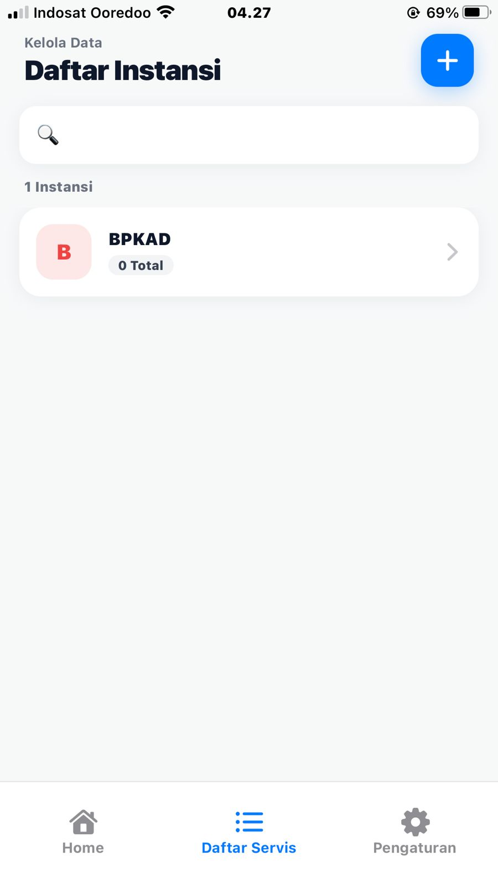
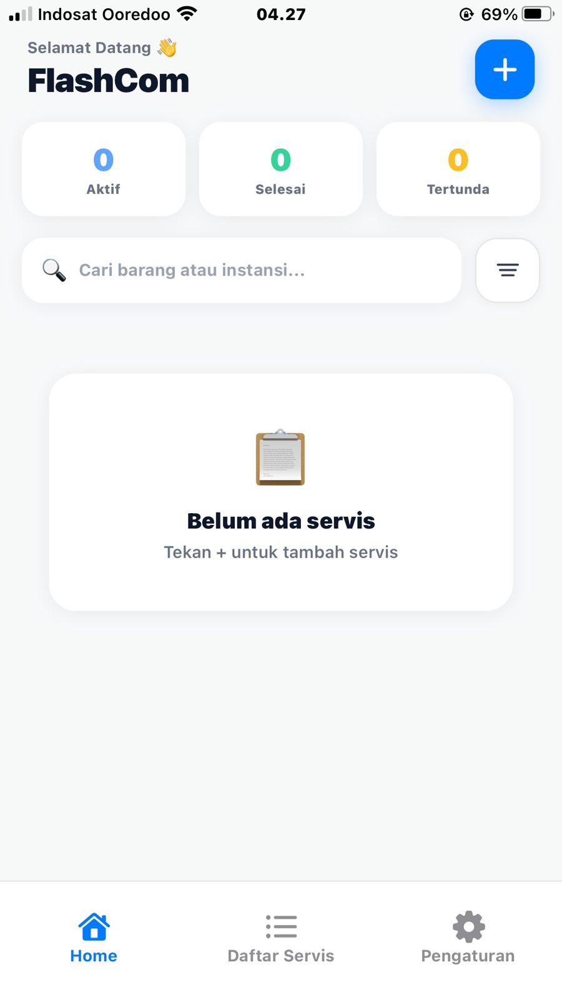
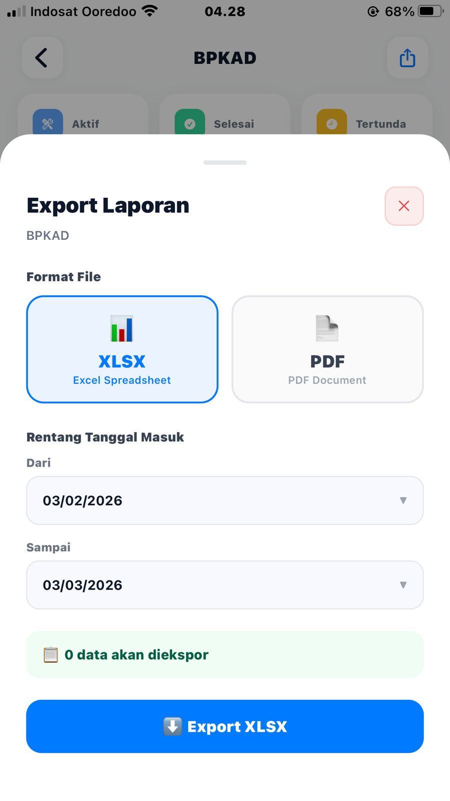
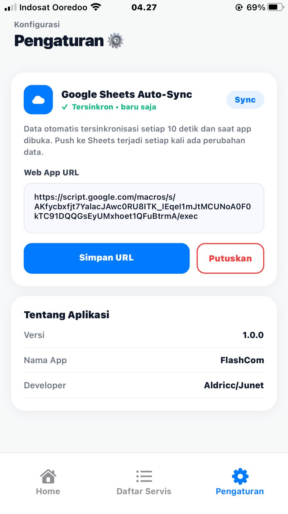
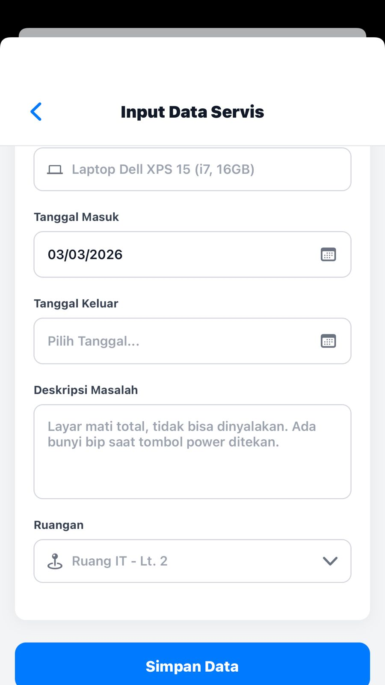

# Flashcom

Aplikasi mobile untuk mencatat dan memantau servis perangkat IT (laptop, printer, CCTV, dll) dari berbagai instansi. Data disimpan di perangkat, dan bisa disinkronkan ke Google Sheets supaya staf lain bisa mengaksesnya dari komputer.

<p>
  
  
  
  
  
</p>

## Fitur

- Catat perangkat yang masuk servis: jenis barang, tanggal masuk, ruangan, dan keterangan perbaikan.
- Ringkasan jumlah servis berdasarkan status: masuk, selesai, tertunda.
- Bisa dipakai tanpa internet. Data disimpan lokal dengan AsyncStorage.
- Sinkronisasi dengan Google Sheets lewat Google Apps Script.
- Ekspor rekap per instansi ke PDF atau Excel (.xlsx), lalu bagikan lewat WhatsApp, email, dll.

## Teknologi

- React Native dengan Expo
- TypeScript
- Expo Router
- `@react-native-async-storage/async-storage` untuk penyimpanan lokal
- `expo-print` (PDF), `xlsx` (Excel), `expo-file-system`, `expo-sharing` untuk ekspor

## Menjalankan di lokal

```bash
git clone https://github.com/Aldricc/ServisApp.git
cd ServisApp
npm install
npx expo start
```

Scan kode QR yang muncul dengan Expo Go (Android/iOS).

## Build APK

Proyek ini memakai EAS Build.

```bash
npx eas-cli login
eas build -p android --profile preview
```

Build biasanya selesai dalam 5-10 menit, lalu kamu akan mendapat link untuk mengunduh APK.

## Setup Google Sheets

1. Buat spreadsheet baru di Google Drive.
2. Buka Extensions > Apps Script.
3. Tempel script `doGet` dan `doPost` (lihat `docs/apps-script.js`), lalu beri otorisasi.
4. Klik Deploy > Web app, set akses ke "Anyone".
5. Salin URL Web App yang dihasilkan.
6. Tempel URL itu di menu Pengaturan di aplikasi.

